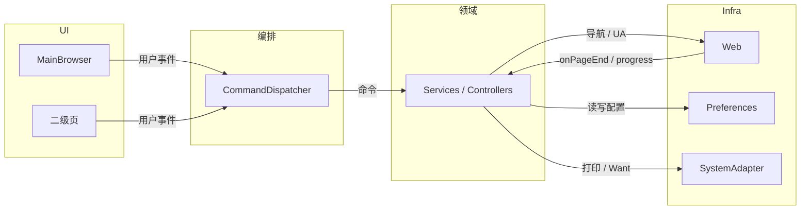
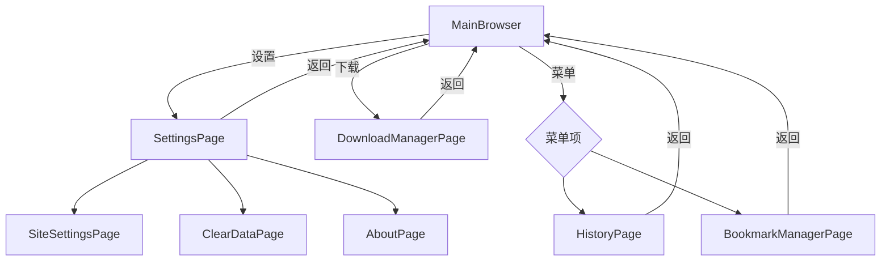

# OpenHarmony 浏览器工具 设计方案

## 1. 文档信息

| 项 | 内容 |
|----|------|
| 文档名称 | OpenHarmony 浏览器工具 设计方案 |
| 版本 | V1.0 |
| 状态 | 正式发布（指导工程实现） |
| 归档路径 | `OpenHarmonyBrowser/OpenHarmony 浏览器工具 设计方案.md` |
| 依据文档 | PRD `OpenHarmony_浏览器工具_PRD.md` V1.1；SDD `OpenHarmony_浏览器工具_SDD.md` V1.2；功能点清单 `OpenHarmony_浏览器工具_功能点文档.md` |
| 目标工程路径 | `OpenHarmonyBrowser/`（Stage 模型 · OpenHarmony 6.0+ · API Level 23） |

**文档定位**：在 PRD / SDD 之上给出 **可直接编码落地的细化规格**：模块间协作约定、页面路由与状态流、Web 与持久化接线要点、兼容性与降级策略。不扩展 PRD 功能范围。

---

## 2. 系统设计（细化 SDD 架构）

### 2.1 层级关系与通信方式

| 层级 | 典型工件 | 向下调用 | 向上反馈 |
|------|-----------|----------|----------|
| UI | `@Entry` 页面、`@Component` 区块 | 调用编排层命令 API | `@State` / `@Observed` / 回调刷新界面 |
| 编排 | `CommandDispatcher`、路由封装 | 同步调用领域服务；异步等待 Promise | 收敛异常为 Toast / Dialog |
| 领域 | `*Service`、`*Controller` | 仅依赖 Infra 抽象 | 返回业务结果对象或抛出业务错误码 |
| Infra | `Web` 封装、`PreferenceRepository`、`SystemCapabilityAdapter` | SDK API | 回调驱动领域更新 |

**约束**：UI **禁止**直接读写 `Preferences` 或裸调 `@kit.ArkWeb`；一律经 Service / Repository。

### 2.2 模块间数据交互（框图）

下列图示与 SDD §4.1 一致，在本方案中强调 **读写方向** 与 **高频路径**。



### 2.3 核心数据流（摘要）

| 场景 | 数据路径 |
|------|----------|
| 提交地址栏 | UI → `AddressBarController.open` → `UrlResolver` → `Web.loadUrl` →（成功）`HistoryService.append`（非无痕） |
| 切换 Tab | UI → `TabManager.activate` → 切换绑定 `Web` 控制器 → UI 同步地址栏与导航按钮态 |
| 收藏 | UI → `BookmarkService.addOrUpdate` → 持久化 → `@Observed` 书签列表刷新书签栏 |
| 下载 | `Web` `onDownloadStart` → `DownloadService.createTask` → 文件管道更新进度 → UI 列表绑定 |
| 清除数据 | UI → 确认对话框 → `HistoryService` / `DownloadService` / Web 清理 API → Toast |

### 2.4 模块接口实现规范（工程约定）

以下为 **逻辑接口契约**（语言为 ArkTS），实现时可合并为类或拆分为文件，但语义不得省略。

**编排层**

```typescript
// 伪代码契约 — 实际以工程 ArkTS 语法为准
interface CommandDispatcher {
  dispatch(cmd: BrowserCommand, ctx: CommandContext): Promise<void>;
}
```

**命令枚举（节选）**：`NAV_BACK`、`NAV_FORWARD`、`NAV_REFRESH`、`NAV_HOME`、`OPEN_DOWNLOAD_MANAGER`、`MENU_PRINT`、`MENU_SAVE_AS`、`MENU_DESKTOP_SHORTCUT`、`SET_UA`、`TAB_NEW`、`TAB_CLOSE`、`BOOKMARK_TOGGLE` …（与 PRD 8.8 / 8.4 / 8.5 对齐）。

**领域服务（节选方法签名语义）**

| 模块 | 方法语义 | 前置条件 / 后置条件 |
|------|----------|---------------------|
| `NavigationController` | `goBack(tabId)` | 无后退栈则 no-op 且 UI `canBack=false` |
| `AddressBarController` | `open(text, tabId)` | 解析失败走搜索 URL；成功后更新 Tab URL |
| `TabManager` | `createTab(mode)` | `NORMAL \| INCOGNITO`；无痕不写常规历史 |
| `BookmarkService` | `syncStarState(url)` | 收藏按钮与树数据一致 |
| `DownloadService` | `clearAll()` | 仅清理记录或连同文件由设置项决定（若有） |

**Infra**

| 模块 | 契约 |
|------|------|
| `PreferenceRepository` | `get<T>(key)` / `set(key, value)` / `flush()`；键名集中定义为常量 |
| `SystemCapabilityAdapter` | 各方法返回 `CapabilityResult { ok, reason? }`，禁止吞异常 |

---

## 3. UI / UX 设计（可开发细化）

### 3.1 页面与路由矩阵

| 路由页（示例名） | PRD 映射 | 进入方式 |
|------------------|----------|----------|
| `pages/MainBrowser` | 主窗口聚合 8.3–8.7、8.8 部分能力 | `EntryAbility` 默认页 |
| `pages/SettingsPage` | 8.9 设置入口聚合 | 顶栏设置、`router.pushUrl` |
| `pages/DownloadManagerPage` | 8.4.5、8.8.7、8.9.4 | 导航下载按钮、菜单 |
| `pages/HistoryPage` | 8.8.6、8.9.9 | 菜单 |
| `pages/BookmarkManagerPage` | 8.8.5、8.9.6 | 菜单 |
| `pages/SiteSettingsPage` | 8.9.5 | 设置 |
| `pages/ClearDataPage` | 8.9.10 | 设置 |
| `pages/AboutPage` | 8.9.13、8.2.2 版本信息 | 设置 |

> 路由注册：`main_pages.json`（或工程等价配置）与上述路径一致；命名可按模板微调，但需在本文档与 README 同步。

### 3.2 页面跳转逻辑（框图）



### 3.3 控件交互细节（与 PRD 对齐）

| 控件 | 交互 | 状态 / 反馈 |
|------|------|-------------|
| 后退 / 前进 | 单击 | `enabled` 绑定 `canBack` / `canForward`；禁用时不响应 |
| 刷新 | 单击 | 触发加载指示直至 `onPageEnd` 或超时策略 |
| 地址栏 | 回车提交 | 非法输入 Toast 或静默转搜索（与 PRD 8.5.1 一致） |
| 地址栏下拉 | 聚焦 / 输入过滤 | 列表来自 `HistoryService`，点击替换地址并导航 |
| 收藏 Star | 单击 | 已收藏实心 / 未收藏空心；长按或二次进入编辑（实现可选） |
| Tab | 点击选中 / 关闭按钮 | 关闭后索引切换到相邻 Tab |
| 书签 chip | 单击跳转 | 长按或右键弹出上下文（PRD 8.7.3） |
| 下载列表项 | 滑动或按钮删除 | 二次确认可选；清空全部须确认 |

### 3.4 色彩与字体（落地约束）

沿用 SDD §5.1 令牌；工程侧约定：

- **浅色**：工具栏背景 `$r('app.color.toolbar_bg')`（自定义资源）略高于内容区灰阶。
- **深色**：跟随 `ColorMode.DARK` 资源限定目录。
- **主强调色**：用于选中 Tab 底边或 Star 填充。
- **字体**：标题 `FontWeight.Medium`；地址栏正文字号不小于正文一级；辅助信息降一级字号 / 降透明度。

### 3.5 适配方案（手机 / 平板 / 可变窗口）

| 维度 | 策略 |
|------|------|
| 最小宽度断点 | 示例：`widthVp < 600` 折叠书签栏为菜单入口；`>=840` 可考虑设置双栏 |
| Tab 溢出 | `Scroll` 横向；保留首尾「新建」按钮固定可见 |
| 触控目标 | 不小于系统推荐最小点击区域；桌面键鼠场景保留 Hover（可选） |
| 平板横屏 | `MediaQuery` 监听；Web 区始终 `layoutWeight(1)` 占满剩余 |

### 3.6 UX 结构引用

主窗口六段带状线框、ASCII 示意及紧凑索引图 **以 SDD §5.2 为准**，本方案不再重复粘贴，避免双源不一致。

---

## 4. 技术设计（ArkTS / Web / 存储 / 异常）

### 4.1 ArkUI 组件拆分建议（MainBrowser）

| 组件职责 | 建议拆分 |
|----------|----------|
| 顶栏 + 窗口控件 | `TitleStrip` 或内联 `Row` |
| 标签栏 | `TabStrip` + `TabItem` |
| 导航按钮组 | `NavButtonGroup` |
| 地址栏区域 | `AddressBar`（含下拉 Layer） |
| 书签栏 | `BookmarkBar` |
| Web | 单一 `Web` + `WebController` 按 Tab 映射 |

状态：`tabs[]`、`activeTabId`、`addressText`、`suggestions[]`、`starred` 等由页面 `@State` 持有或通过 ViewModel 类聚合（禁止散落在全局可变单例 unless documented）。

### 4.2 Web 组件封装与调用

- **控制器**：每 Tab 独立 `WebController`（或等价 ArkWeb API）；切换 Tab 时切换可见 `Web` 与控制器绑定。
- **事件**：订阅加载开始 / 结束 / 错误 / 标题变更 / SSL 错误（按 SDK 可用列表）；用于更新 `loading`、`title`、`canBack`。
- **下载**：实现 `onDownloadStart`（或当前 SDK 等价钩子）转发 `DownloadService`。
- **UA**：在设置变更后对当前控制器调用 `setCustomUserAgent`（若 API 存在）；否则文档注明降级策略。
- **查找 / 缩放**：调用文档化的 ArkWeb 页内查找与缩放 API；不可用则菜单项 `enabled:false` 并 Toast。

### 4.3 数据存储方案

| 数据类 | 存储介质 | 键前缀示例 | 说明 |
|--------|----------|------------|------|
| 全局设置 | Preferences | `settings.` | 起始页、默认引擎、UA、安全浏览 |
| 书签树 | Preferences 或单 JSON 文件 | `bm.` | 体量过大时改文件 + 索引（迭代可选） |
| 历史 | Preferences / 轻量数据库 | `his.` | 需上限与 LRU 策略 |
| 下载记录 | Preferences | `dl.` | 仅存元数据；文件本体在用户目录 |
| 站点策略摘要 | Preferences | `site.` | 与 PRD 8.9.5 展示一致 |

**一致性**：写入路径唯一经 `PreferenceRepository`；批量更新使用同一异步队列避免覆盖。

### 4.4 异常处理实现逻辑

| 异常类型 | UI | 领域 | Infra |
|----------|-----|------|-------|
| 网络错误页 | 展示重试按钮 | 记录失败 URL | Web `onErrorReceive` |
| 下载失败 | 列表状态 `FAILED` | `errorCode` 枚举 | 文件 IO 捕获 |
| Preferences 失败 | Toast | 回滚内存状态 | 打印 hilog |
| 系统能力不可用 | Toast / 隐藏菜单项 | `CapabilityResult` | 特性检测 |

---

## 5. 兼容性设计（OpenHarmony 6.0+ · API 23）

### 5.1 编译与运行矩阵

| 项 | 要求 |
|----|------|
| `compileSdkVersion` | 23 |
| `targetSdkVersion` | 23 |
| `compatibleSdkVersion` | 23 |
| `runtimeOS` | OpenHarmony |

### 5.2 设备差异

| 能力 | 手机 | 平板 | 说明 |
|------|------|------|------|
| 多窗口 / 桌面最小化 | 视产品形态 | 常见 | `minimize` 等 API 标注 optional capability（与 SDD 一致） |
| 打印 / 快捷方式 | 依赖系统 | 依赖系统 | `SystemCapabilityAdapter` 统一降级 |
| 横竖屏 | 均有 | 均有 | `MediaQuery` |

### 5.3 Syscap 与降级清单（实现阶段补齐）

建议在工程中维护表格：**Syscap / API → 功能点 → 降级行为**，随集成测试结果更新；验收时对照 PRD 非功能「系统能力不可用」条款。

---

## 6. PRD 追溯索引（设计方案章节）

| PRD 章节域 | 本文档章节 |
|------------|------------|
| 8.1–8.2 UX / 文档 | §3 UI/UX；README 在阶段 4 产出 |
| 8.3 窗口 | §2、§5.2；实现对接 WM |
| 8.4–8.7 | §3.3、§4.1、`MainBrowser` 拆分 |
| 8.8 菜单 | §2.4 命令枚举；§3.2 |
| 8.9 设置 | §3.1 路由矩阵；§4.3 |
| 8.10 右键 | §2.4 `ContextMenuService`（详细菜单项在开发计划子文档展开） |
| 非功能 | §4.4、§5 |

---

## 7. 修订记录

| 版本 | 说明 |
|------|------|
| V1.0 | 首版归档至 `OpenHarmonyBrowser/`，对齐 PRD V1.1 与 SDD V1.2 |

> （注：部分内容可由 AI 辅助起草，须研发按 SDK 最终 API 校准后冻结。）
