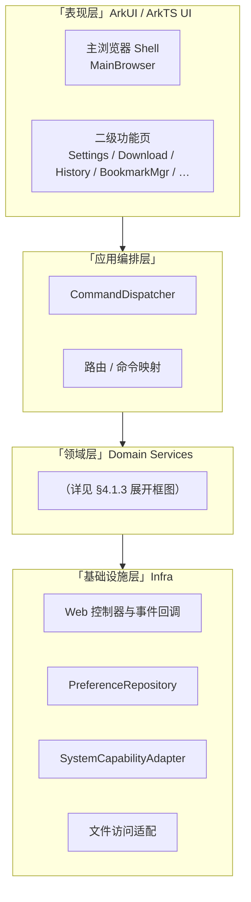
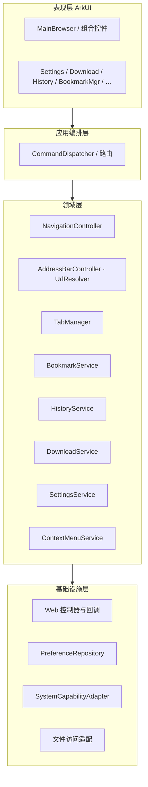
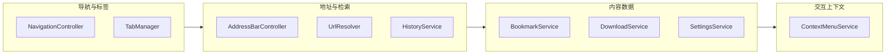
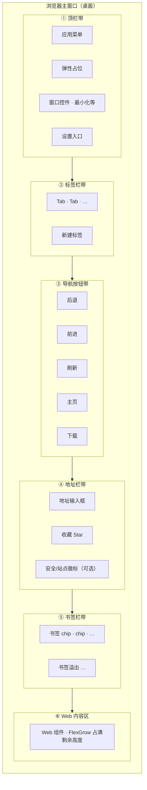
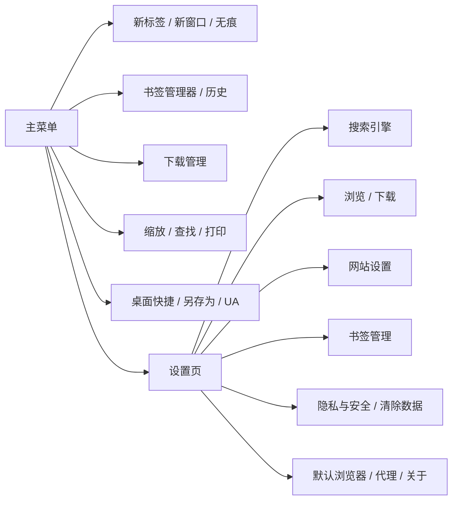
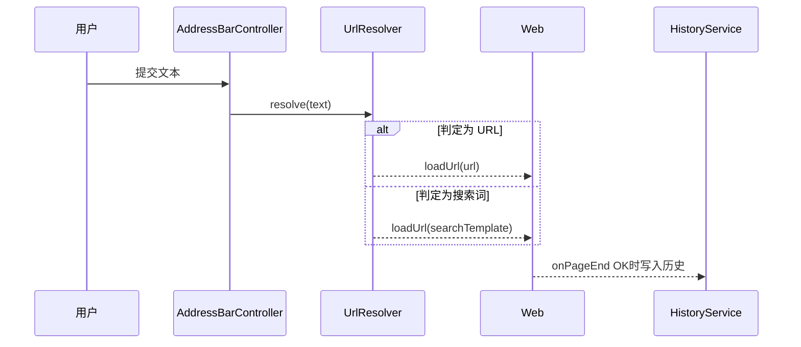

# OpenHarmony 浏览器工具 系统方案设计文档（SDD）

## 1. 文档信息

| 项 | 内容 |
|----|------|
| 文档名称 | OpenHarmony 浏览器工具 系统方案设计文档（SDD） |
| 版本 | V1.2 |
| 状态 | 正式版（用于评审 / 开发） |
| 归档路径 | `OpenHarmonyBrowser/OpenHarmony_浏览器工具_SDD.md` |
| 需求依据 | `OpenHarmonyBrowser/OpenHarmony_浏览器工具_PRD.md` **V1.1** 全量章节 |
| 功能点清单 | `OpenHarmonyBrowser/OpenHarmony_浏览器工具_功能点文档.md` |
| 适配范围 | `OpenHarmony_standard_p7885_20260414`、OpenHarmony 6.0+、API Level 23 |
| 技术栈 | 纯 ArkTS + ArkUI、Stage 模型、系统原生 Web（`Web` / `@kit.ArkWeb` 能力以 SDK 为准），无第三方内核与第三方业务 SDK |

---

## 2. 设计目标与原则

### 2.1 设计目标

- 对 **PRD V1.1** 全部功能点进行 **100% 可对齐的技术方案**，不扩 scope。
- 采用 OpenHarmony **原生分层架构**，兼顾桌面浏览器场景的性能与可维护性。
- UX 与控件语义遵循 **HarmonyOS Design Guidelines**：清晰层级、可达性、一致反馈。

### 2.2 设计原则

- **单一职责**：导航、地址、标签、书签、设置、下载、历史、上下文菜单等边界清晰。
- **高内聚低耦合**：ArkUI 负责展示与事件；领域服务承载规则；Infra 封装 Web、Preferences、文件与系统能力。
- **单一数据源**：标签列表、当前 Tab、地址栏文本、收藏状态等与持久化策略一致，避免双写。
- **可追溯**：PRD 章节 → SDD 模块 → 接口 → 测试用例可双向映射（见 §14）。

---

## 3. 系统上下文与技术边界

### 3.1 运行环境

- **系统**：OpenHarmony 标准（分支 `OpenHarmony_standard_p7885_20260414`）。
- **版本**：OpenHarmony 6.0+；**compileSdk / targetSdk / compatibleSdk：23**。
- **形态**：桌面窗口化浏览器应用（窗口缩放、最小化依赖 **窗口管理 / WM** 能力）。
- **构建**：DevEco Studio / hvigor；SDK：`C:\Users\Administrator\AppData\Local\OpenHarmony\Sdk`（以本机为准）。

### 3.2 技术边界

| 类别 | 边界说明 |
|------|----------|
| 渲染 | 网页内容由 **系统 Web 组件** 渲染；内核行为与 API 以 SDK 文档为准。 |
| 下载 | 下载管线依赖 Web 回调与 **文件管理（含权限）**；失败须用户可感知。 |
| 系统能力 | 打印、桌面快捷方式、默认浏览器、代理、打开文件夹等依赖 **系统能力与设备型号**；不可用时应降级提示（PRD 非功能一致）。 |
| 无痕 | 语义满足 PRD：常规历史等不按常规模式持久化；具体隔离策略（独立存储标识 / 会话）以实现阶段结合 SDK 选定。 |

---

## 4. 总体架构设计

### 4.1 分层架构

以下三张图为同一架构的不同粒度：**纵向四层框图**（全貌）、**调用关系框图**（箭头）、**领域层模块展开框图**（便于编码分包对齐）。

#### 4.1.1 分层架构框图（自上而下）



> 说明：箭头表示自上而下的 **分层依赖方向**（概况）；各层内部模块与调用细节见 **§4.1.2**、**§4.1.3**。

#### 4.1.2 分层调用关系框图（控制流）



#### 4.1.3 领域层模块展开框图（分包参考）



**职责简述**

- **表现层**：顶栏（菜单、窗口控件）、标签栏、导航按钮、地址栏、书签栏、`Web` 区域；二级页面路由。
- **应用编排**：菜单项、快捷键（若有）、右键动作统一映射为 **命令**（导航 / 打开页 / 调系统能力）。
- **领域层**：URL 与搜索引擎规则、标签生命周期、书签树、历史队列、下载状态机、设置聚合。
- **基础设施**：ArkWeb 生命周期与进度事件、Preferences 持久化、Want / 文件选择器 / 打印等系统封装。

### 4.2 核心模块（与 PRD 映射）

| 模块 | 职责摘要 | PRD 主要章节 |
|------|-----------|----------------|
| `WindowControls` / WM | 最小化、尺寸变化监听（缩放多为系统边框） | 8.3 |
| `NavigationController` | 前进 / 后退 / 刷新 / 主页 | 8.4 |
| `AddressBarController` | URL / 搜索、历史下拉、收藏按钮状态 | 8.5 |
| `TabManager` | 新建 / 关闭 / 切换、标签右键 | 8.6 |
| `BookmarkService` | 书签栏数据、CRUD、导入导出、书签栏右键 | 8.7、8.9.6 |
| `MenuService` | 主菜单与子菜单项完整性与路由 | 8.8 |
| `DownloadService` | 任务列表、进度、清空、删除、打开目录 | 8.4.5、8.8.7、8.9.3–8.9.4 |
| `HistoryService` | 写入（非无痕）、列表、删除、地址栏联想 | 8.5.3、8.9.9 |
| `SettingsService` | 搜索引擎、起始页、安全浏览、站点摘要等 | 8.9 |
| `ContextMenuService` | 网页四类上下文 + 地址栏 / 标签 / 书签栏右键策略 | 8.5.4、8.6.2、8.7.3、8.10 |
| `SystemCapabilityAdapter` | 打印、快捷方式、另存为、默认浏览器、代理入口 | 8.8.10–8.8.12、8.9.11–8.9.12 |
| `PersistenceRepository` | Preferences（或等价）统一读写 | §8 |

### 4.3 数据与控制流（文字）

用户操作 → UI 事件 → **CommandDispatcher** → 领域服务更新内存模型并调用 Infra（`Web` 导航、写 Preferences、拉起系统界面）→ 异步结果通过状态绑定刷新 ArkUI。

---

## 5. UX 设计规范与界面结构（HarmonyOS Design Guidelines）

> 本节约束：**层级清晰、触控 / 键鼠友好、状态可见**。色值与字号在具体工程中优先使用 **主题 Token / 资源限定词**（如 `dark`、`tablet`），避免硬编码分散。

### 5.1 设计令牌（建议）

| 令牌用途 | 规范取向 |
|----------|-----------|
| 色彩 | **背景**：主界面使用中性浅色或深色背景（跟随系统主题）；**主品牌色**用于强调按钮与选中 Tab；**分割线**低对比度。**语义色**：成功 / 警告 / 错误用于下载状态与 Toast。 |
| 字体 | 使用鸿蒙系统字体阶梯：**标题**（页面标题）> **子标题**（分组）> **正文**（列表 / 地址栏）> **辅助说明**（时间与路径）；桌面可适当增大最小可读字号。 |
| 间距 | 8 vp 网格：**紧凑型工具栏** 垂直 padding 与控件间距取 8–12 vp；列表项垂直 12–16 vp。 |
| 圆角 | 下拉菜单 / 对话框遵循系统控件默认圆角；书签 chips 可用 **胶囊形** 以区别于方形图标按钮。 |
| 图标 | 导航箭头、刷新、主页、下载等使用 **语义清晰** 的线性或填充图标套装，尺寸与触摸目标不小于鸿蒙建议最小点击区域。 |

### 5.2 主浏览器窗口信息架构（线框）

#### 5.2.1 主窗口纵向分区框图（界面带状结构）

下列 **Mermaid** 图将主窗口自上而下分为 **6 个带状区域**；每一带内部再用 **横向框** 标出主要控件槽位（与实现布局 `Column` + `Row` 对应）。



#### 5.2.2 线框简化示意（纯文本框图）

便于在未渲染 Mermaid 的环境下评审版面分区：

```text
┌──────────────────────────────────────────────────────────────┐
│ ① 顶栏    [应用菜单]              [─ □ ✕]           [设置]   │
├──────────────────────────────────────────────────────────────┤
│ ② 标签栏  [ Tab1 ][ Tab2 ][ Tab3 ] …           [ ＋ 新标签 ] │
├──────────────────────────────────────────────────────────────┤
│ ③ 导航栏  [ ◀ ][ ▶ ][ ⟳ ][ ⌂ ][ ⭳ 下载 ]                     │
├──────────────────────────────────────────────────────────────┤
│ ④ 地址栏  [ https://………………………………………………… ★ ] [🔒]             │
├──────────────────────────────────────────────────────────────┤
│ ⑤ 书签栏  [ 书签A ][ 书签B ][ 文件夹▾ ] …                     │
├──────────────────────────────────────────────────────────────┤
│ ⑥ Web 内容区（ ArkUI Web，占满剩余区域）                     │
│                                                              │
│                                                              │
└──────────────────────────────────────────────────────────────┘
```

#### 5.2.3 原紧凑版线框（索引图）


**交互要点（对齐 PRD）**

- **禁用态**：前进 / 后退在无历史栈时 **置灰**，符合 8.4.1–8.4.2。
- **加载态**：刷新按钮旁或地址栏显示 **加载指示**（环形进度或骨架）。
- **无痕**：窗口或 Tab 条呈现 **视觉区分**（角标 / 色调条），满足 8.8.4。

### 5.3 主菜单与二级页面导航



路由建议：**二级功能页** 统一使用 **路由栈 push**，返回保持 Web 状态；清除数据、删除书签等使用 **二次确认对话框**（Harmony 标准 `AlertDialog` 范式）。

### 5.4 设置列表页布局模式

- **分组列表**：`List` + `ListItemGroup`，每组标题为 **二级标题样式**。
- **开关类**：右侧 `Toggle`，变更立即写 Preferences 并反馈 Toast（可选）。
- **跳转类**（默认浏览器、代理）：右侧 chevron，点击进入系统设置或说明页。

### 5.5 下载管理列表

- 每项：**文件名（主）** + **状态 / 进度（辅）** + **操作**（打开目录、删除）。
- 空状态：插图 + 文案「暂无下载任务」，引导从网页发起下载。

### 5.6 适配（手机 / 平板 / 窗口尺寸）

| 场景 | 策略 |
|------|------|
| 平板宽屏 | 书签栏可横向滚动；地址栏 flex 优先占满；可考虑 **双栏设置**（左导航右详情）若工时允许。 |
| 窄屏 / 小窗口 | 书签栏默认 **可折叠** 或收入菜单；标签过多时 **横向滚动**。 |
| 横竖屏 | `MediaQuery` / 窗口尺寸监听调整顶栏折行或隐藏次要图标。 |

---

## 6. 模块详细设计

### 6.1 窗口管理模块

- **输入**：最小化点击、窗口尺寸变化。
- **输出**：窗口状态；布局重新测算。
- **要点**：缩放以 **系统边框与标题栏** 为主（PRD 8.3.1）；应用内可选暴露缩放入口但非替代系统行为。

### 6.2 导航与地址模块

- **URL 决策**：`UrlResolver` — 判定 scheme / 域名；否则拼接默认搜索引擎模板。
- **历史联想**：`HistoryService.queryPrefix(text)`，排除无痕写入路径。
- **收藏按钮**：根据当前 URL 是否在书签集合切换填充态。

### 6.3 标签管理模块

- **模型**：`Tab { id, title, url, loading, canBack, canForward, isIncognito }`。
- **新建**：绑定独立 `Web` 控制器实例（策略以实现为准）。
- **关闭**：释放控制器；焦点切换到相邻 Tab。
- **右键**：菜单项与 PRD 8.6.2 一致（关闭 / 关闭其他 / 复制链接等 —— 具体条目在实现阶段与 PRD 验收对齐）。

### 6.4 书签管理模块

- **模型**：`BookmarkItem`、`BookmarkFolder` 树表。
- **导入导出**：Netscape HTML 书签格式为 **默认互操作格式**；编码 UTF-8。
- **书签栏右键**：空白处与书签项 **上下文拆分**（PRD 8.7.3）。

### 6.5 菜单管理模块

- **配置化**：`MenuItem { id, label, action, visible, enabled, children[] }`。
- **动作**：一律进入 `CommandDispatcher`，覆盖 PRD 8.8 全部子项。

### 6.6 设置中心模块

- 子模块与 PRD 8.9 一一对应；持久化键值集中在 `SettingsService`，禁止页面私自读写 Preferences。

### 6.7 下载管理模块

- **模型**：`DownloadTask { id, url, fileName, savePath, status, progress, totalBytes, createdAt, updatedAt, errorCode }`。
- **状态机**：`QUEUED → DOWNLOADING → COMPLETED | FAILED | CANCELLED`。
- **异常**：网络中断、权限失败、磁盘满 → **可追踪错误码 + UI 提示**。

### 6.8 历史记录与数据清理模块

- **模型**：`HistoryItem { id, url, title, visitTime, visitCount }`。
- **清理**：按 PRD 8.9.10 类别映射到本地列表删除 + **Web 数据清理 API**（若 SDK 提供 Cookie / Cache 清理接口则接入）。

### 6.9 网页右键菜单模块

- **上下文枚举**：`Blank | Image | Link | SelectedText`。
- **流水线**：Web 上下文菜单事件 → 构造菜单 Model → 用户选择 → `CommandDispatcher`。

### 6.10 系统能力适配模块

| 能力 | 封装接口（示例） | 说明 |
|------|------------------|------|
| 打印 | `printCurrentPage(tabId)` | 调用系统打印；失败 Toast |
| 桌面快捷方式 | `createDesktopShortcut(meta)` | meta：标题、URL、图标 |
| 网页另存为 | `savePageAs(tabId, uri)` | 依赖 Web / 文件选择器 |
| 打开目录 | `openFileInFolder(path)` | 下载「在文件夹中显示」 |
| 默认浏览器 | `setAsDefaultBrowser()` | Want 跳转系统设置 |
| 代理 | `openProxySettings()` | 跳转系统网络或代理页 |

---

## 7. 关键业务流程

### 7.1 地址栏提交（序列）



### 7.2 收藏流程（简述）

点击收藏 → 查询 URL 是否已存在 → 新增或编辑 `BookmarkItem` → 刷新书签栏 UI → `BookmarkService.persist()`。

### 7.3 下载流程（简述）

Web `onDownloadStart` → `DownloadService.createTask` → 写入下载目录 → 更新进度 → 完成 / 失败状态 → 列表刷新。

### 7.4 清除浏览数据

用户勾选类别 → 二次确认 → `HistoryService` / `DownloadService` / Web 清理接口按需调用 → 刷新 UI → Toast 结果。

---

## 8. 数据设计

### 8.1 本地持久化域

| 逻辑集合 | 内容 |
|----------|------|
| `browser_settings` | 起始页、主页、默认搜索引擎 ID、UA 预设、安全浏览开关等 |
| `bookmarks` | 书签树序列化 |
| `history` | 历史记录列表（上限策略可实现阶段定义） |
| `downloads` | 下载任务记录 |
| `site_policies` | 站点权限 / 展示策略摘要 |

### 8.2 一致性

- **单写入口**：各 Service 对外 API 写入；Repository 不暴露给 UI。
- **失败回滚**：持久化失败时恢复内存旧状态并提示。

---

## 9. 接口设计（内部）

### 9.1 领域服务（节选）

```text
NavigationController.goBack(tabId)
NavigationController.goForward(tabId)
NavigationController.refresh(tabId)
AddressBarController.open(inputText, tabId)
TabManager.createTab(mode: NORMAL | INCOGNITO)
TabManager.closeTab(tabId)
BookmarkService.addOrUpdate(item) / remove(urlOrId)
DownloadService.createTask(req) / remove(taskId) / clearAll()
HistoryService.append(...) / query(condition) / clear(scope)
SettingsService.get(key) / update(key, value)
ContextMenuService.build(type, payload) / dispatch(action)
```

### 9.2 系统适配（节选）

见 §6.10 表格。

---

## 10. 安全与隐私设计

- **无痕与常规** 数据路径区分存储或标记（实现阶段定稿）。
- **站点权限** 变更可追溯（本地日志或持久摘要）。
- **清除数据** 必须确认对话框，防误触。
- **关于页**：版本、`bundleName`、开源许可声明（PRD 8.2.2）。

---

## 11. 异常与容错设计

| 异常 | 处理 |
|------|------|
| 页面加载失败 | Web 错误页或占位 + **重试** |
| 下载失败 | `FAILED` + 原因 + 删除 / 重试 |
| Preferences 失败 | 不回写；Toast |
| 系统能力不可用 | 禁用入口或说明「当前设备不支持」 |

---

## 12. 测试设计与验收

### 12.1 分层

- **单元测试**：URL 解析、下载状态机、书签导入解析。
- **集成测试**：地址栏 → Web → 历史写入闭环。
- **UI / 手工**：菜单覆盖率、右键场景、设置持久化。
- **系统能力**：打印、快捷方式等在 **目标真机** 抽样。

### 12.2 验收

与 PRD **§9 矩阵** 全通过；API 23 编译与目标系统运行验证。

---

## 13. 交付物对应（PRD 文档类功能点）

| PRD | 交付 |
|-----|------|
| 8.2.1 设计说明书 | 本文档 SDD + 下一阶段《OpenHarmony 浏览器工具 设计方案.md》 |
| 8.2.2 开源 Readme | 工程根目录 `README.md`（阶段 4 产出） |

---

## 14. PRD–SDD 追溯矩阵（摘要）

| PRD 章节域 | SDD 主要承载 |
|------------|----------------|
| 8.1 UX | §5 UX 令牌与 IA |
| 8.3 窗口 | §6.1、`WindowControls` |
| 8.4 导航栏 | §6.2、`NavigationController` |
| 8.5 地址栏 | §6.2、`AddressBarController`、`HistoryService` |
| 8.6 标签 | §6.3、`TabManager` |
| 8.7 书签栏 | §6.4、`BookmarkService` |
| 8.8 菜单 | §6.5、`MenuService`、`CommandDispatcher` |
| 8.9 设置 | §6.6、`SettingsService` |
| 8.9.4 下载管理 | §6.7、`DownloadService` |
| 8.10 网页右键 | §6.9、`ContextMenuService` |
| 8.8.10–12 / 8.9.11–12 | §6.10、`SystemCapabilityAdapter` |

---

## 15. 归档与变更控制

- 代码与缺陷单应引用 **PRD 章节号**（如 8.5.1）与 **模块名**。
- SDD 变更需同步更新版本号与修订记录。

### 修订记录

| 版本 | 说明 |
|------|------|
| V1.0 | 初始合并稿（历史见仓库 `OpenHarmony_浏览器工具_PRD_SDD.md` SDD 部分） |
| V1.1 | **归档至 OpenHarmonyBrowser/**；对齐 **PRD V1.1**；新增 **§5 HarmonyOS UX**（令牌 + Mermaid 线框）；补充追溯与交付说明 |
| V1.2 | **§4.1** 拆分为纵向四层框图、分层调用框图、领域层模块展开框图；**§5.2** 增强带状分区 Mermaid 框图并增补 ASCII 纯文本线框 |

> （注：部分内容可由 AI 辅助起草，须架构 / 研发对照 SDK 与 PRD 核准后冻结。）
