# 1 功能概述

## 1.1 业务目标

浏览器应用是OpenHarmony标准系统中预置的系统应用，为用户提供主页与导航、标签页管理、网页浏览与交互、搜索功能、书签与历史记录、下载管理、安全与隐私、设置与个性化、系统集成等功能。

## 1.2 需求范围

phone形态：

- 主页与导航
- 标签页管理
- 网页浏览与交互
- 搜索功能
- 书签与历史记录
- 下载管理
- 安全与隐私
- 设置与个性化
- 系统集成

# 2 整体方案设计

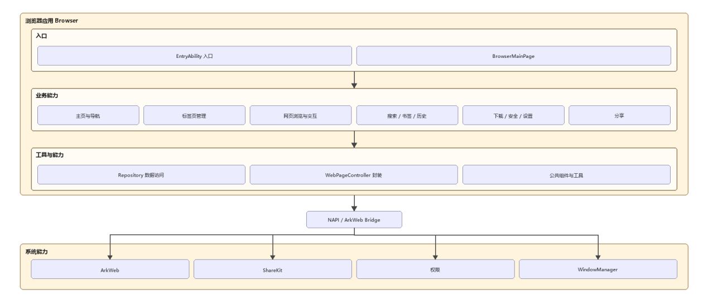

图 2.0  手机浏览器系统整体架构图

## 2.1 架构设计

浏览器系统内部采用五层结构：

| **层次** | **职责** | **典型组件** |
| --- | --- | --- |
| UI 层 | 页面布局与用户操作 | 主页、浏览页、标签管理、各类对话框 |
| 业务层 | 标签、导航、书签、下载等业务编排 | TabManager、NavigationController、BrowserApp |
| Web 层 | 网页渲染、交互、下载委托 | WebPageController、DownloadDelegate |
| 数据层 | 持久化与缓存 | BookmarkRepository、HistoryRepository、SettingsStore |
| 系统层 | 分享、权限、证书、媒体库 | ShareService、PermissionService、SslHandler |

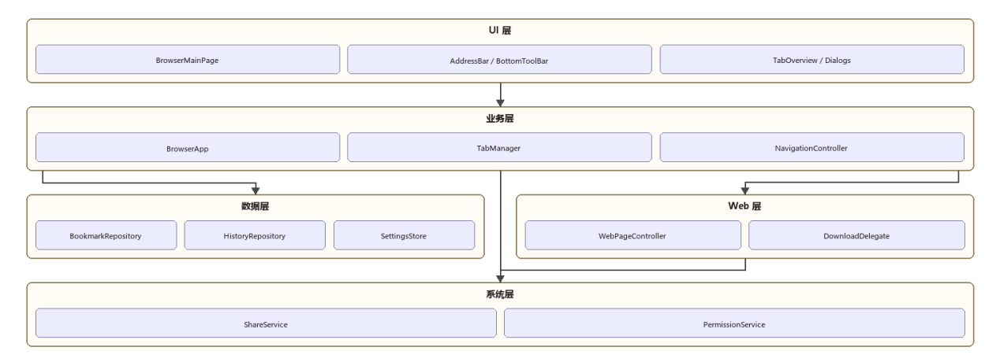

图 2-1  手机浏览器系统分层架构图

## 2.2 效果图

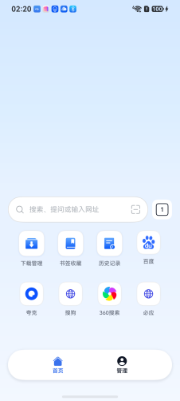

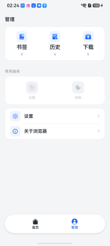
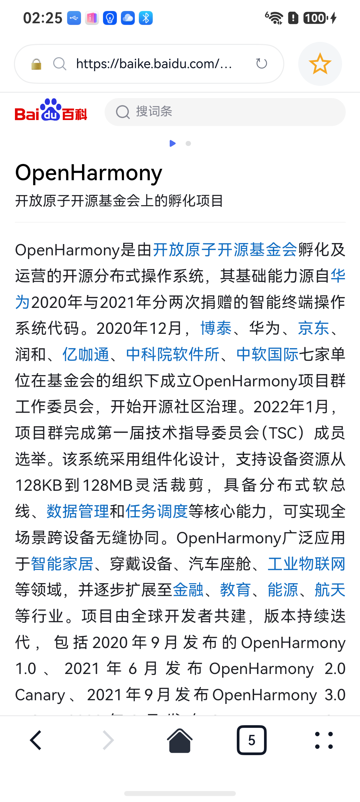

## 2.3 模块划分

### 2.3.1 功能模块

| **模块** | **职责** |
| --- | --- |
| 主页与导航 | 地址栏、快捷方式、顶部/底部工具栏、手势 |
| 标签页管理 | 新建、切换、关闭、缩略图、无痕标签 |
| 网页浏览 | 加载、刷新、停止、上下文菜单、缩放 |
| 搜索 | 地址栏搜索、建议、页内查找 |
| 书签与历史 | 书签 CRUD、历史分组与清理、无痕策略 |
| 下载管理 | 触发、确认、进度、列表与重试 |
| 安全与隐私 | SSL、站点权限 |
| 设置与集成 | 搜索引擎、主题、关于、系统分享 |

### 2.3.2 核心类职责

| **类/模块** | **职责** |
| --- | --- |
| BrowserApp | 应用级初始化、配置加载、模块装配 |
| TabManager | 标签 CRUD、活跃标签、无痕标志、状态快照 |
| TabSession | 单标签 URL、标题、Web 状态、缩略图路径 |
| AddressBar | 输入、补全、安全标识、星标、分享入口 |
| BottomToolBar | 返回/前进/主页/标签/更多 |
| ShortcutManager | 预置与用户快捷方式持久化 |
| IncognitoPolicy | 无痕写入拦截与会话清理 |
| HistoryGrouper | 历史记录时间分组与批量删除 |
| DownloadManager | 任务队列、进度、暂停与重试 |
| SettingsStore | 搜索引擎、主题、无图/夜间开关 |

### 2.3.3核心类关系图

下图描述业务层核心类型及其依赖关系（组合、关联与数据写入）。

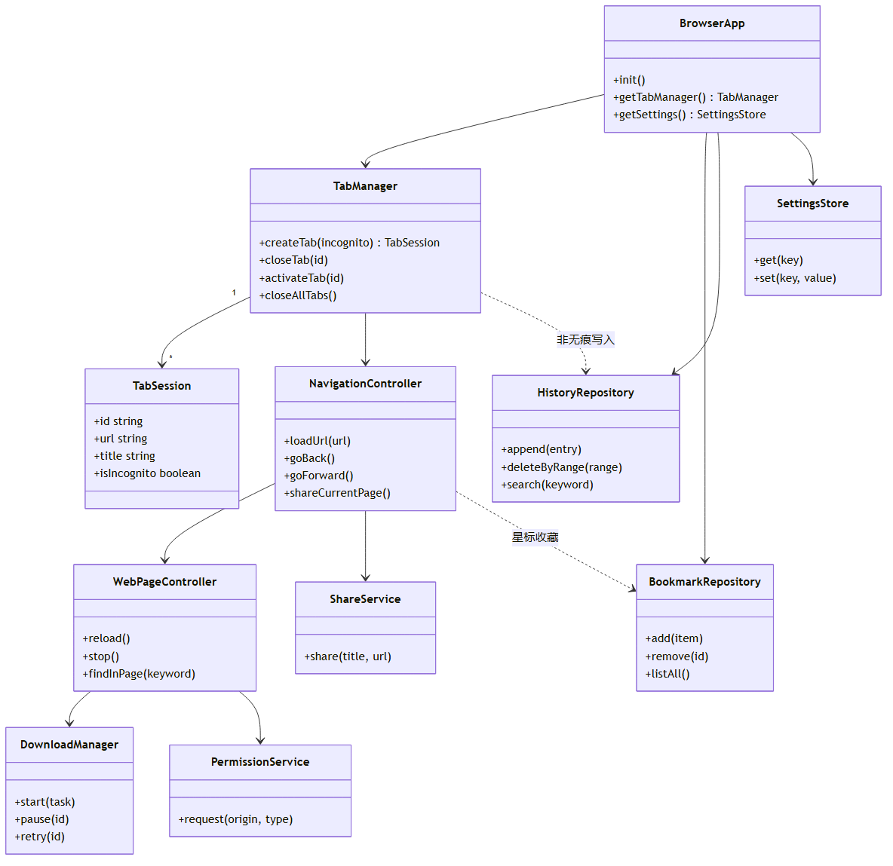

图 2.3.3  手机浏览器核心类关系图

### 2.3.4 代码目录

| **路径** | **说明** |
| --- | --- |
| entry/src/main/ets/entryability/ | EntryAbility |
| entry/src/main/ets/pages/ | 主页、浏览页、标签概览 |
| entry/src/main/ets/components/ | 地址栏、工具栏、快捷方式网格 |
| entry/src/main/ets/services/ | TabManager、DownloadManager、ShareService |
| entry/src/main/ets/repository/ | 书签、历史、设置、快捷方式 |
| entry/src/main/ets/model/ | TabSession、BookmarkItem 等数据结构 |
| entry/src/main/ets/dialogs/ | 权限、SSL、下载确认 |
| entry/src/main/resources/ | 字符串、图标、主题 |

### 2.3.5 数据设计

#### 2.3.5.1存储规则

数据采用数据库方式存储，表设计如下：

| **数据** | **数据库表** | **Repository** | **主要操作** |
| --- | --- | --- | --- |
| **设置** | **browser_settings** | **SettingsRepository** | **浏览器设置** |
| **书签** | **bookmarks** | **BookmarkRepository** | **树形 CRUD、排序、按 URL 查重** |
| **历史****记录** | **history_entries** | **HistoryRepository** | **插入、按日期分组查询、搜索、删除** |
| **快捷方式** | ** shortcuts** | **ShortcutManager** | **预置导入、用户增删、拖动更新 sort_order** |
| **标签 WebState** | **tab_sessions** | **TabRepository** | **保存/恢复会话、活跃标签标记；无痕跳过** |
| **下载元数据** | **download_tasks** | **DownloadRepository** | **任务状态机、进度更新、列表查询** |

**数据库表设计：**

**browser_settings 应用设置**

| **字段** | **类型** | **约束** | **说明** |
| --- | --- | --- | --- |
| **setting_key** | **TEXT** | **PRIMARY KEY** | **设置键** |
| **setting_value** | **TEXT** | **NOT NULL** | **设置值** |
| **updated_at** | **INTEGER** | **NOT NULL** | **最后修改时间戳（毫秒）** |

**bookmarks 书签**

| **字段** | **类型** | **约束** | **说明** |
| --- | --- | --- | --- |
| **id** | **TEXT** | **PRIMARY KEY** | **书签/文件夹唯一 ID** |
| **parent_id** | **TEXT** | **FK → bookmarks.id** | **父文件夹 ID，NULL 为根级** |
| **title** | **TEXT** | **NOT NULL** | **显示名称** |
| **url** | **TEXT** | **NULL** | **目标地址，文件夹为 NULL** |
| **icon_url** | **TEXT** | **NULL** | **网站图标缓存路径** |
| **sort_order** | **INTEGER** | **NOT NULL** | **同级排序权重** |
| **is_folder** | **INTEGER** | **NOT NULL** | **1 文件夹，0 书签** |
| **created_at** | **INTEGER** | **NOT NULL** | **创建时间戳（毫秒）** |
| **updated_at** | **INTEGER** | **NOT NULL** | **更新时间戳（毫秒）** |

**history_entries 浏览历史**

| **字段** | **类型** | **约束** | **说明** |
| --- | --- | --- | --- |
| **id** | **INTEGER** | **PRIMARY KEY AUTOINCREMENT** | **自增主键** |
| **url** | **TEXT** | **NOT NULL** | **访问地址** |
| **title** | **TEXT** | **NOT NULL** | **页面标题** |
| **visited_at** | **INTEGER** | **NOT NULL** | **访问时间戳（毫秒）** |
| **icon_url** | **TEXT** | **NULL** | **网站图标缓存路径** |
| **visit_count** | **INTEGER** | **NOT NULL** | **同 URL 累计访问次数** |

**shortcuts 主页快捷方式**

| **字段** | **类型** | **约束** | **说明** |
| --- | --- | --- | --- |
| **id** | **TEXT** | **PRIMARY KEY** | **快捷方式 ID** |
| **title** | **TEXT** | **NOT NULL** | **显示名称** |
| **url** | **TEXT** | **NOT NULL** | **目标地址** |
| **icon_url** | **TEXT** | **NULL** | **图标路径或 URL** |
| **sort_order** | **INTEGER** | **NOT NULL** | **主页网格排序** |
| **is_preset** | **INTEGER** | **NOT NULL** | **1 系统预置，0 用户自定义** |
| **created_at** | **INTEGER** | **NOT NULL** | **创建时间戳（毫秒）** |
| **updated_at** | **INTEGER** | **NOT NULL** | **更新时间戳（毫秒）** |

**tab_sessions 标签页会话**

| **字段** | **类型** | **约束** | **说明** |
| --- | --- | --- | --- |
| **id** | **TEXT** | **PRIMARY KEY** | **标签唯一 ID** |
| **title** | **TEXT** | **NOT NULL** | **页面标题** |
| **url** | **TEXT** | **NOT NULL** | **当前 URL** |
| **is_incognito** | **INTEGER** | **NOT NULL** | **1 无痕标签** |
| **web_state** | **TEXT** | **NULL** | **ArkWeb 可序列化状态（JSON）** |
| **thumbnail_path** | **TEXT** | **NULL** | **缩略图缓存路径** |
| **sort_order** | **INTEGER** | **NOT NULL** | **标签栏顺序** |
| **is_active** | **INTEGER** | **NOT NULL** | **1 表示最后活跃标签** |
| **created_at** | **INTEGER** | **NOT NULL** | **创建时间戳（毫秒）** |
| **updated_at** | **INTEGER** | **NOT NULL** | **最后更新时间戳（毫秒）** |

**download_tasks 下载任务元数据**

| **字段** | **类型** | **约束** | **说明** |
| --- | --- | --- | --- |
| **id** | **TEXT** | **PRIMARY KEY** | **任务 ID** |
| **file_name** | **TEXT** | **NOT NULL** | **文件名** |
| **source_url** | **TEXT** | **NOT NULL** | **下载源 URL** |
| **local_path** | **TEXT** | **NULL** | **本地保存路径** |
| **status** | **TEXT** | **NOT NULL** | **pending/running/paused/done/failed** |
| **progress** | **INTEGER** | **NOT NULL** | **0–100** |
| **file_size** | **INTEGER** | **NULL** | **文件总大小（字节）** |
| **mime_type** | **TEXT** | **NULL** | **MIME 类型** |
| **error_message** | **TEXT** | **NULL** | **失败原因** |
| **created_at** | **INTEGER** | **NOT NULL** | **创建时间戳（毫秒）** |
| **updated_at** | **INTEGER** | **NOT NULL** | **更新时间戳（毫秒）** |

#### 2.3.5.2 数据实体对象设计

TabSession 标签页

| **字段** | **类型** | **说明** |
| --- | --- | --- |
| id | string | 标签唯一 ID |
| title | string | 页面标题 |
| url | string | 当前 URL |
| isIncognito | boolean | 是否无痕 |
| webState | object | ArkWeb 可序列化状态 |
| thumbnailPath | string | 缩略图缓存路径（可选） |

BookmarkItem 书签

| **字段** | **类型** | **说明** |
| --- | --- | --- |
| id | string | 书签 ID |
| parentId | string | 文件夹父节点 |
| title | string | 显示名称 |
| url | string | 目标地址 |
| iconUrl | string | 网站图标存储位置 |

HistoryEntry 历史记录

| **字段** | **类型** | **说明** |
| --- | --- | --- |
| url | string | 访问地址 |
| title | string | 标题 |
| visitedAt | number | 时间戳 |
| iconUrl | string | 网站图标存储位置 |

DownloadTask 下载任务

| **字段** | **类型** | **说明** |
| --- | --- | --- |
| id | string | 任务 ID |
| fileName | string | 文件名 |
| localPath | string | 本地路径 |
| status | enum | pending/running/paused/done/failed |
| progress | number | 0–100 |

Settings 设置

| **键** | **类型** | **说明** |
| --- | --- | --- |
| defaultSearchEngine | string | 默认引擎 ID |
| themeMode | string | light/dark/system |
| imageLessMode | boolean | 无图模式 |
| nightMode | boolean | 夜间模式 |

# 3 功能设计

## 3.1 主页与导航

### 3****.1.1 功能****概述

提供主页、浏览态导航栏及手势操作，支撑网址输入、搜索入口与快捷访问。

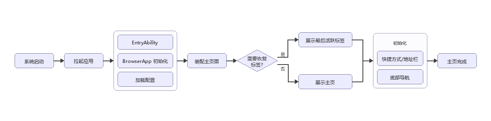

图 3.1.1.1  手机浏览器系统启动流程图

### 3.1.2 主页展示

1 主页

| **区域** | **子项** | **规格要点** |
| --- | --- | --- |
| 顶部搜索 / 地址栏 | - | 统一的网址输入与搜索入口 |
| 顶部搜索 / 地址栏 | 扫一扫 | 点击扫一扫可以扫描二维码打开网址 |
| 常用网站快捷方式 | 系统默认快捷方式 | 预置百度、必应等主流搜索引擎 |
| 常用网站快捷方式 | 用户自定义快捷方式 | 用户可添加自己常用的网站 |
| 常用网站快捷方式 | 快捷方式编辑 | 支持添加、删除、拖动排序快捷方式 |
| 底部导航栏 | 主页按钮 | 一键返回浏览器主页 |
| 底部导航栏 | 标签页按钮 | 进入标签页管理界面 |
| 底部导航栏 | 更多按钮 | 展开更多功能菜单 |

### 3.1.3 导航栏

顶部地址栏

| **区域** | **子项** | **规格要点** |
| --- | --- | --- |
| 网址输入与显示 | 自动补全网址 | 根据历史记录和常用网址补全 |
| 网址输入与显示 | 网址安全标识 | 显示 HTTPS 锁形图标、危险网站警告 |
| 网址输入与显示 | 复制 / 粘贴网址 | 快速复制和粘贴当前网址 |
| 网址输入与显示 | 分享网址 | 调用系统分享面板分享当前页面 |
| 搜索功能入口 | - | 输入关键词直接搜索 |
| 刷新 / 停止按钮 | - | 加载中显示停止，加载完成显示刷新 |

底部工具栏

| **按钮** | **行为** |
| --- | --- |
| 返回按钮 | 返回上一页 |
| 前进按钮 | 前进到下一页 |
| 主页按钮 | 一键返回主页 |
| 标签页管理按钮 | 进入标签页列表 |
| 更多功能按钮 | 展开更多操作菜单 |

### 3.1.4 手势导航

页面导航手势

| **手势** | **行为** |
| --- | --- |
| 左边缘右滑 | 从屏幕左边缘向右滑动返回上一页，在首页则退出 |
| 右边缘左滑 | 从屏幕左边缘向右滑动返回上一页，在首页则退出 |

标签页手势

| **手势** | **行为** |
| --- | --- |
| 标签页左滑关闭 | 在标签页缩略图上向左滑动关闭标签 |

## 3.2 标签页管理

### 3****.****2****.1 功能****概述

支持多标签并行浏览，提供新建、切换、关闭及批量管理能力。

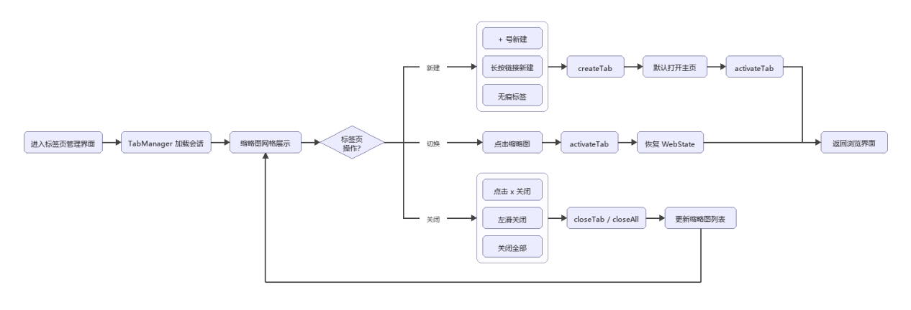

### 3.2.2 标签页基本操作

新建标签页

| **操作** | **行为** |
| --- | --- |
| 点击 + 号新建 | 标签页管理界面点击加号按钮 |
| 长按链接新建 | 长按链接选择 "在新标签页中打开" |
| 新建标签页默认打开主页 | 新标签页启动后显示主页 |

切换标签页

| **操作** | **行为** |
| --- | --- |
| 点击缩略图切换 | 点击标签页管理界面的缩略图 |

关闭标签页

| **操作** | **行为** |
| --- | --- |
| 点击 × 号关闭 | 点击标签页右上角的关闭按钮 |
| 左滑关闭 | 标签页缩略图左滑关闭 |
| 关闭所有标签页 | 一键关闭全部打开的标签页 |

## 3.3 网页浏览与交互

### 3.3.1 功能概述

**支持浏览网页的相关功能，支持与网页交互操作**

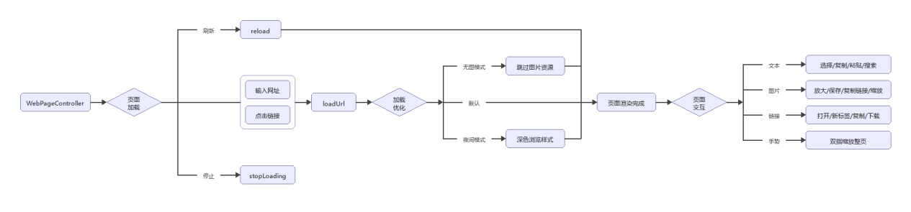

图 3.3.1  网页浏览与交互流程图

### 3.3.2 页面加载

基本加载

| **能力** | **说明** |
| --- | --- |
| 输入网址加载 | 在地址栏输入网址后加载页面 |
| 点击链接加载 | 点击网页内的链接加载新页面 |
| 刷新页面 | 重新加载当前页面 |
| 停止加载 | 中断正在进行的页面加载 |

加载优化

| **能力** | **说明** |
| --- | --- |
| 无图模式 | 禁止或跳过图片资源加载以节省流量 |
| 夜间模式 | 深色浏览样式，可与全局主题协同 |

### 3.3.3 页面交互

文本操作

| **操作** | **说明** |
| --- | --- |
| 长按选中文本 | 长按网页文本弹出选择菜单 |
| 复制文本 | 复制选中的文本内容 |
| 粘贴文本 | 在输入框中粘贴复制的内容 |
| 全选文本 | 选中当前输入框内的所有文本 |
| 搜索选中文本 | 用默认搜索引擎搜索选中的文本 |

图片操作

| **操作** | **说明** |
| --- | --- |
| 点击放大查看 | 点击图片全屏放大查看 |
| 长按保存到相册 | 长按图片选择保存到手机相册 |
| 长按复制图片链接 | 复制图片的网络地址 |
| 双指缩放图片 | 放大查看时双指缩放图片大小 |
| 长按分享图片 | 分享图片文件或链接 |

链接操作

| **操作** | **说明** |
| --- | --- |
| 点击链接打开 | 点击链接在当前标签页打开 |
| 长按在新标签页打开 | 长按链接选择在新标签页打开 |
| 长按复制链接地址 | 复制链接的 URL |

### 3.3.4 页面显示

缩放控制

| **操作** | **说明** |
| --- | --- |
| 双指缩放页面 | 双指张开 / 捏合缩放整个页面 |

## 3.4 搜索功能

### 3.4.1 功能概述

网页的搜索功能，支持使用默认搜索引擎搜索输入的内容

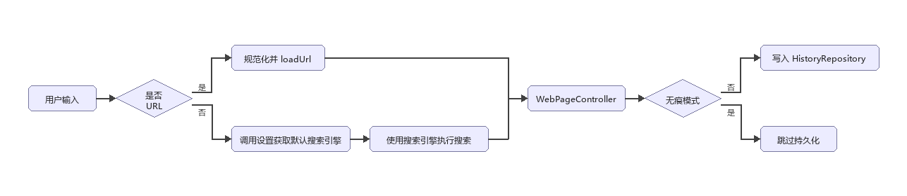

图 3.4  地址栏导航与搜索流程图

### 3.4.2 基本搜索

地址栏搜索

| 输入关键词直接搜索 | - | 地址栏输入非网址内容自动搜索 |
| --- | --- | --- |
| 搜索建议 | 历史搜索建议 | 显示用户之前搜索过的关键词 |
| 搜索建议 | 网址补全建议 | 补全可能的网址 |

搜索引擎选择

| 默认搜索引擎设置 | 内置主流搜索引擎 | 支持百度、必应、搜狗、360 搜索 |
| --- | --- | --- |

### 3.4.3 页面内搜索

页面内查找

| **操作** | **说明** |
| --- | --- |
| 输入关键词高亮显示 | 输入后所有匹配项高亮 |
| 上一个 / 下一个匹配项 | 快速跳转到前后匹配位置 |

## 3.5 书签与历史记录

### 3.5.1 功能概述

**保存用户使用过的历史网页记录，支持保存为书签，当用户打开无痕模式时，不保存历史记录和Cookie 和表单数据等**

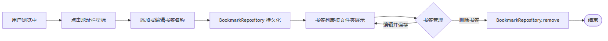

图 3.5.1.1  书签流程图

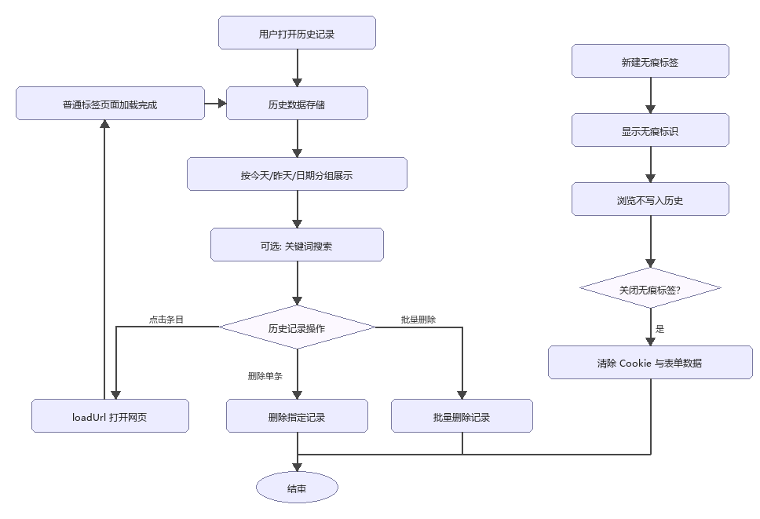

图 3.5.1.2  历史记录流程图

### 3.5.2 书签管理

添加书签

| **操作** | **说明** |
| --- | --- |
| 点击星形图标添加 | 地址栏右侧星形按钮一键添加 |
| 编辑书签名称 | 添加时可修改书签显示名称 |

查看书签

| **能力** | **说明** |
| --- | --- |
| 书签列表显示 | 按文件夹层级显示书签 |

编辑书签

| **能力** | **说明** |
| --- | --- |
| 编辑书签信息 | 修改书签名称和网址 |
| 删除书签 | 删除不需要的书签 |

### 3.5.3 历史记录

查看历史记录

| **能力** | **说明** |
| --- | --- |
| 按时间分组显示 | 按今天/昨天/日期（月日/年月日）分组 |
| 历史记录搜索 | 搜索历史访问过的网页 |

历史记录操作

| **能力** | **说明** |
| --- | --- |
| 点击打开网页 | 点击历史记录条目打开对应网页 |
| 删除单条历史记录 | 删除指定的一条历史记录 |
| 批量删除 | 长按记录，进入批量删除模式，包含全选，删除 |

无痕模式

| **能力** | **说明** |
| --- | --- |
| 新建无痕标签页 | 打开一个无痕浏览标签 |
| 不保存历史记录 | 无痕模式下的浏览不记录历史 |
| 不保存 Cookie 和表单数据 | 退出无痕模式后自动清除相关数据 |
| 无痕模式标识 | 显示明显的无痕模式提示 |

## 3.6 下载管理

### 3.6.1 功能概述

**实现下载功能的相关管理能力**

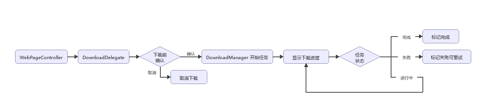

图 3.6  文件下载流程图

### 3.6.2 基本下载

下载触发

| **能力** | **说明** |
| --- | --- |
| 点击下载链接自动开始 | 点击下载链接触发下载 |
| 长按链接选择下载 | 长按普通链接选择 "下载链接" |
| 下载前确认 | 显示文件大小和类型，用户确认后下载 |

下载过程

| **能力** | **说明** |
| --- | --- |
| 显示下载进度 | 实时显示下载进度条和百分比 |
| 暂停 / 继续下载 | 暂停和恢复正在进行的下载 |
| 取消下载 | 取消正在进行的下载 |

### 3.6.3 下载管理

查看下载记录

| **能力** | **说明** |
| --- | --- |
| 按时间排序显示 | 按下载时间倒序显示所有记录 |
| 显示下载状态 | 区分完成 / 失败 / 进行中状态 |

下载文件操作

| **能力** | **说明** |
| --- | --- |
| 删除下载文件 | 删除下载记录和本地文件 |
| 重新下载失败文件 | 对下载失败的任务重新下载 |

## 3.7 安全与隐私

### 3.7.1 功能描述

**支持浏览器与手机权限的安全隐私相关的设置操作**

### 3.7.2 隐私保护

网站权限管理

| **能力** | **说明** |
| --- | --- |
| 位置权限管理 | 允许 / 禁止网站获取位置信息 |
| 相机 / 麦克风权限管理 | 允许 / 禁止网站使用相机和麦克风 |
| 通知权限管理 | 允许 / 禁止网站发送通知 |

## 3.8 设置与个性化

### 3.8.1 功能概述

**用户对浏览器应用的个性化设置操作**

### 3.8.2 基本设置

浏览设置

| 默认搜索引擎设置 | 设置全局默认搜索引擎 |
| --- | --- |
| 清理Cookie | 点击清理手机存储的Cookie和网站缓存数据 |

### 3.8.3 高级设置

关于浏览器

| 版本信息 | 显示当前浏览器版本号 |
| --- | --- |

### 3.8.4 个性化设置

主题设置

| 浅色 / 深色 | 两种主题模式选择 |
| --- | --- |

## 3.9 系统集成

### 3.9.1 功能概述

**网页的分享功能，支持将当前网页****分享****到微信、QQ、短信等**

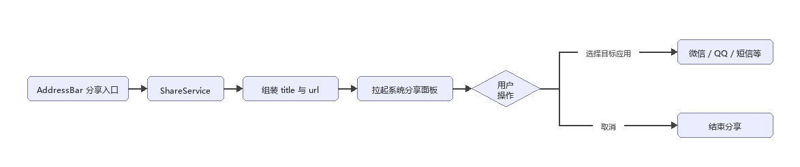

图 3.9  网页分享流程图

### 3.9.2 基础系统集成

1、分享功能

| **能力** | **说明** |
| --- | --- |
| 分享网页链接 | 分享当前页面的 URL 和标题 |
| 支持所有系统分享目标 | 微信、QQ、短信等 |

## 3.10 系统接口与依赖

### 3.10.1 ArkWeb

| **能力** | **接口** |
| --- | --- |
| 加载 | WebviewController.loadUrl |
| 导航 | backward、forward、accessBackward |
| 刷新/停止 | refresh、stop |
| 下载 | WebDownloadDelegate |
| 页内查找 | 控制器查找 API（以官网文档为准） |

### 3.10.2 ShareKit

通过系统分享能力传递 title、url；须在 UI线程调用；失败时提示用户。

### 3.10.3 权限与存储

| **能力** | **用途** |
| --- | --- |
| 位置/相机/麦克风 | 站点权限 |
| 媒体库 | 图片保存 |
| 网络 | 页面加载与下载 |
| 文件管理 | 下载文件保存和管理 |

### 3.10.4 国际化

跟随系统语言切换，支持中/英文，默认中文，其他语言时使用中文

# 4 特性清单

## 4.1 浏览器

| **L1（中文）** | **L2（中文）** | **L3（中文）** | **L4（中文）** | **L5特性** | **层级** |
| --- | --- | --- | --- | --- | --- |
| 主页与导航 | 主页展示 | 简洁主页 | 顶部搜索 / 地址栏 | - | L4 |
| 主页与导航 | 主页展示 | 简洁主页 | 常用网站快捷方式 | 系统默认快捷方式 | L5 |
| 主页与导航 | 主页展示 | 简洁主页 | 常用网站快捷方式 | 用户自定义快捷方式 | L5 |
| 主页与导航 | 主页展示 | 简洁主页 | 常用网站快捷方式 | 快捷方式编辑 | L5 |
| 主页与导航 | 主页展示 | 简洁主页 | 底部导航栏 | 主页按钮 | L5 |
| 主页与导航 | 主页展示 | 简洁主页 | 底部导航栏 | 标签页按钮 | L5 |
| 主页与导航 | 主页展示 | 简洁主页 | 底部导航栏 | 更多按钮 | L5 |
| 主页与导航 | 导航栏 | 顶部地址栏 | 网址输入与显示 | 自动补全网址 | L5 |
| 主页与导航 | 导航栏 | 顶部地址栏 | 网址输入与显示 | 网址安全标识 | L5 |
| 主页与导航 | 导航栏 | 顶部地址栏 | 网址输入与显示 | 复制 / 粘贴网址 | L5 |
| 主页与导航 | 导航栏 | 顶部地址栏 | 网址输入与显示 | 分享网址 | L5 |
| 主页与导航 | 导航栏 | 顶部地址栏 | 搜索功能入口 | - | L4 |
| 主页与导航 | 导航栏 | 顶部地址栏 | 刷新 / 停止按钮 | - | L4 |
| 主页与导航 | 导航栏 | 底部工具栏 | 返回按钮 | - | L4 |
| 主页与导航 | 导航栏 | 底部工具栏 | 前进按钮 | - | L4 |
| 主页与导航 | 导航栏 | 底部工具栏 | 主页按钮 | - | L4 |
| 主页与导航 | 导航栏 | 底部工具栏 | 标签页管理按钮 | - | L4 |
| 主页与导航 | 导航栏 | 底部工具栏 | 更多功能按钮 | - | L4 |
| 主页与导航 | 手势导航 | 页面导航手势 | 左边缘右滑返回 | - | L4 |
| 主页与导航 | 手势导航 | 页面导航手势 | 右边缘左滑前进 | - | L4 |
| 主页与导航 | 手势导航 | 标签页手势 | 标签页左滑关闭 | - | L4 |
| 标签页管理 | 标签页基本操作 | 新建标签页 | 点击 + 号新建 | - | L4 |
| 标签页管理 | 标签页基本操作 | 新建标签页 | 长按链接新建 | - | L4 |
| 标签页管理 | 标签页基本操作 | 新建标签页 | 新建标签页默认打开主页 | - | L4 |
| 标签页管理 | 标签页基本操作 | 切换标签页 | 点击缩略图切换 | - | L4 |
| 标签页管理 | 标签页基本操作 | 关闭标签页 | 点击 × 号关闭 | - | L4 |
| 标签页管理 | 标签页基本操作 | 关闭标签页 | 左滑关闭 | - | L4 |
| 标签页管理 | 标签页基本操作 | 关闭标签页 | 关闭所有标签页 | - | L4 |
| 网页浏览与交互 | 页面加载 | 基本加载 | 输入网址加载 | - | L4 |
| 网页浏览与交互 | 页面加载 | 基本加载 | 点击链接加载 | - | L4 |
| 网页浏览与交互 | 页面加载 | 基本加载 | 刷新页面 | - | L4 |
| 网页浏览与交互 | 页面加载 | 基本加载 | 停止加载 | - | L4 |
| 网页浏览与交互 | 页面加载 | 加载优化 | 无图模式 | - | L4 |
| 网页浏览与交互 | 页面加载 | 加载优化 | 夜间模式 | - | L4 |
| 网页浏览与交互 | 页面交互 | 文本操作 | 长按选中文本 | - | L4 |
| 网页浏览与交互 | 页面交互 | 文本操作 | 复制文本 | - | L4 |
| 网页浏览与交互 | 页面交互 | 文本操作 | 粘贴文本 | - | L4 |
| 网页浏览与交互 | 页面交互 | 文本操作 | 全选文本 | - | L4 |
| 网页浏览与交互 | 页面交互 | 文本操作 | 搜索选中文本 | - | L4 |
| 网页浏览与交互 | 页面交互 | 图片操作 | 点击放大查看 | - | L4 |
| 网页浏览与交互 | 页面交互 | 图片操作 | 长按保存到相册 | - | L4 |
| 网页浏览与交互 | 页面交互 | 图片操作 | 长按复制图片链接 | - | L4 |
| 网页浏览与交互 | 页面交互 | 图片操作 | 双指缩放图片 | - | L4 |
| 网页浏览与交互 | 页面交互 | 图片操作 | 长按分享图片 | - | L4 |
| 网页浏览与交互 | 页面交互 | 链接操作 | 点击链接打开 | - | L4 |
| 网页浏览与交互 | 页面交互 | 链接操作 | 长按在新标签页打开 | - | L4 |
| 网页浏览与交互 | 页面交互 | 链接操作 | 长按复制链接地址 | - | L4 |
| 网页浏览与交互 | 页面显示 | 缩放控制 | 双指缩放页面 | - | L4 |
| 搜索功能 | 基本搜索 | 地址栏搜索 | 输入关键词直接搜索 | - | L4 |
| 搜索功能 | 基本搜索 | 地址栏搜索 | 搜索建议 | 历史搜索建议 | L5 |
| 搜索功能 | 基本搜索 | 地址栏搜索 | 搜索建议 | 网址补全建议 | L5 |
| 搜索功能 | 基本搜索 | 搜索引擎选择 | 默认搜索引擎设置 | 内置主流搜索引擎 | L5 |
| 搜索功能 | 页面内搜索 | 页面内查找 | 输入关键词高亮显示 | - | L4 |
| 搜索功能 | 页面内搜索 | 页面内查找 | 上一个 / 下一个匹配项 | - | L4 |
| 书签与历史记录 | 书签管理 | 添加书签 | 点击星形图标添加 | - | L4 |
| 书签与历史记录 | 书签管理 | 添加书签 | 编辑书签名称 | - | L4 |
| 书签与历史记录 | 书签管理 | 查看书签 | 书签列表显示 | - | L4 |
| 书签与历史记录 | 书签管理 | 编辑书签 | 编辑书签信息 | - | L4 |
| 书签与历史记录 | 书签管理 | 编辑书签 | 删除书签 | - | L4 |
| 书签与历史记录 | 历史记录 | 查看历史记录 | 按时间分组显示 | - | L4 |
| 书签与历史记录 | 历史记录 | 查看历史记录 | 历史记录搜索 | - | L4 |
| 书签与历史记录 | 历史记录 | 历史记录操作 | 点击打开网页 | - | L4 |
| 书签与历史记录 | 历史记录 | 历史记录操作 | 删除单条历史记录 | - | L4 |
| 书签与历史记录 | 历史记录 | 历史记录操作 | 批量删除，清除全部历史记录 | - | L4 |
| 书签与历史记录 | 历史记录 | 无痕模式 | 新建无痕标签页 | - | L4 |
| 书签与历史记录 | 历史记录 | 无痕模式 | 不保存历史记录 | - | L4 |
| 书签与历史记录 | 历史记录 | 无痕模式 | 不保存 Cookie 和表单数据 | - | L4 |
| 书签与历史记录 | 历史记录 | 无痕模式 | 无痕模式标识 | - | L4 |
| 下载管理 | 基本下载 | 下载触发 | 点击下载链接自动开始 | - | L4 |
| 下载管理 | 基本下载 | 下载触发 | 长按链接选择下载 | - | L4 |
| 下载管理 | 基本下载 | 下载触发 | 下载前确认 | - | L4 |
| 下载管理 | 基本下载 | 下载过程 | 显示下载进度 | - | L4 |
| 下载管理 | 基本下载 | 下载过程 | 暂停 / 继续下载 | - | L4 |
| 下载管理 | 基本下载 | 下载过程 | 取消下载 | - | L4 |
| 下载管理 | 下载管理 | 查看下载记录 | 按时间排序显示 | - | L4 |
| 下载管理 | 下载管理 | 查看下载记录 | 显示下载状态 | - | L4 |
| 下载管理 | 下载管理 | 下载文件操作 | 删除下载文件 | - | L4 |
| 下载管理 | 下载管理 | 下载文件操作 | 重新下载失败文件 | - | L4 |
| 安全与隐私 | 隐私保护 | 网站权限管理 | 位置权限管理 | - | L4 |
| 安全与隐私 | 隐私保护 | 网站权限管理 | 相机 / 麦克风权限管理 | - | L4 |
| 安全与隐私 | 隐私保护 | 网站权限管理 | 通知权限管理 | - | L4 |
| 设置与个性化 | 基本设置 | 浏览设置 | 默认搜索引擎设置 | - | L4 |
| 设置与个性化 | 高级设置 | 关于浏览器 | 版本信息 | - | L4 |
| 设置与个性化 | 个性化设置 | 主题设置 | 浅色 / 深色 / 跟随系统 | - | L4 |
| 系统集成 | 基础系统集成 | 分享功能 | 分享网页链接 | - | L4 |
| 系统集成 | 基础系统集成 | 分享功能 | 支持所有系统分享目标 | - | L4 |

# 5 非功能设计

## 5.1 资料

根据现有代码结构和功能输出应用架构图和代码目录结构说明

## 5.2 是否涉及XTS用例

浏览器不涉及XTS

# 6规格约束

| 规格项 | 规格项 | 指标 |
| --- | --- | --- |
| 性能 | 应用启动时长 | 各系统应用启动时长： 响应时延≤250ms 加载时延≤600ms 完成时延≤1.6s |
| 性能 | 页面跳转 | 各系统应用内页面切换时间： 响应时延≤250ms 加载时延≤600ms 完成时延≤1.6s |
| 性能 | 帧率 | 各系统应用内页面浏览： 平均帧率≥54帧 |
| 稳定性 | 稳定性测试 | 系统应用运行稳定，无Crash，无冻屏、应用错误、死机重启；  
应用崩溃&应用冻屏的故障率要求达成每小时<1次。 |
